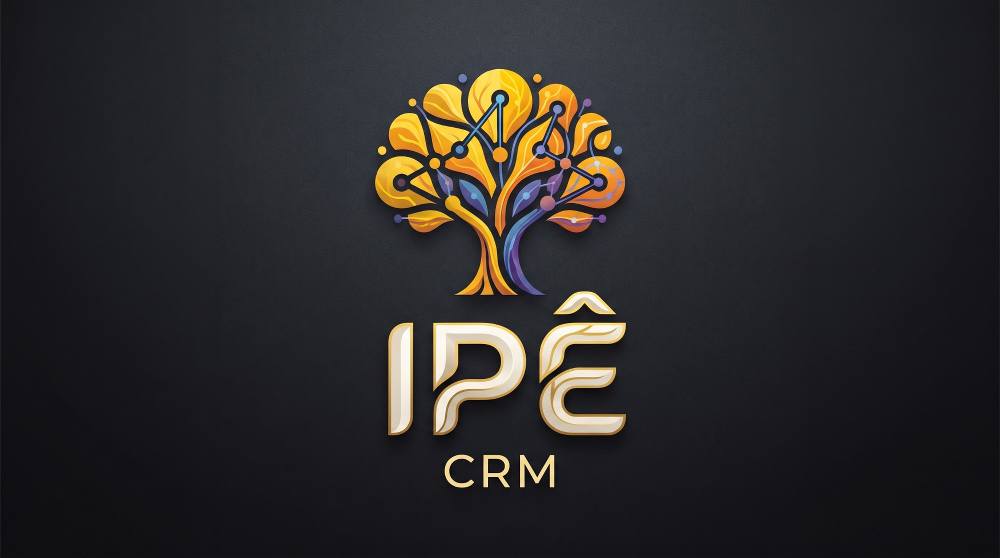

# Ipê CRM



CRM de desktop para Windows para quem prospecta pelo WhatsApp com um bot. Cada mensagem que o bot manda ou recebe aparece no funil em até 2 segundos, sem planilha e sem digitar nada.

## Como funciona

O bot grava um evento por linha em `crm-eventos.jsonl` (`{ em, leadId, numero, tipo, ... }`). O app vigia esse arquivo e move o lead de etapa:

| Evento | O que muda |
|---|---|
| `enviado` | A contatar → Contatado, retorno em 2 dias úteis |
| `mensagem_cliente` | → Respondeu, retorno hoje |
| `orcamento`, `qualificacao`, `previa_pedida` | prioridade Alta, retorno hoje |
| `reuniao` | → Reunião |
| `sem_interesse`, `optout` | → Perdido |
| `humano`, `sem_whatsapp` | só registra no histórico |

Lead que ainda não existe é criado a partir das filas `prospeccao/fila*.json`. Quem escreve sem estar em fila vira `whatsapp-<número>`.

Os leads ficam em `dados/crm/leads.json`, no seu computador. Nada vai para a nuvem.

## Rodar

```
npm install
npm test
npm start
```

Na primeira vez, se não achar a pasta padrão, o app pergunta onde fica a pasta `dados` do bot.

## Gerar o instalador

```
npm run dist
```

Sai em `dist/Ipe-CRM-Instalador-<versão>.exe`.

## Licença

MIT
